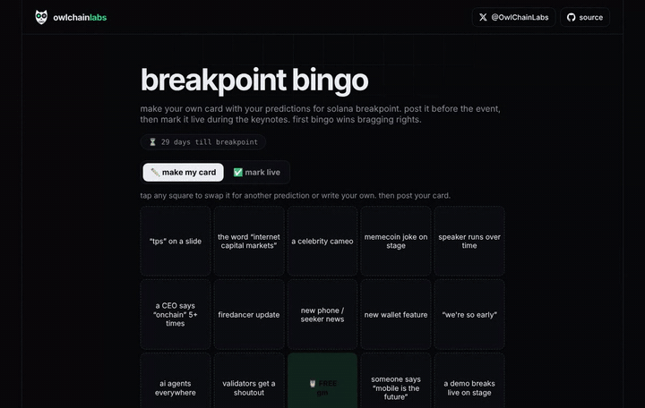

# 🎯 breakpoint bingo

every card is different. post yours before breakpoint, mark it live during the keynotes, tag your frens.

**get your card: [bingo.owlchainlabs.xyz](https://bingo.owlchainlabs.xyz)**



## what it does

- starts you with a random 5x5 card out of 35 breakpoint predictions
- tap any square to swap it for another prediction or write your own
- switch to "mark live" during the keynotes, bingo is detected automatically
- every card gets its own link: x shows an image of exactly your card, and the link opens it for everyone
- tag friends, or save your card as an image
- your card and marks are saved in your browser

## add your own predictions

all squares live in `public/pool.json`. open a PR with your best one. only add to the end of the list, shared links point to squares by position.

## run it yourself

a static page in `public/` plus a small cloudflare worker (`worker.js`) that gives every card its own link and share image. the image is drawn by the og route in [wallet-roast](https://github.com/OwlChainLabs/wallet-roast).

```bash
git clone https://github.com/OwlChainLabs/breakpoint-bingo
cd breakpoint-bingo
npx wrangler dev
```

just for fun, not affiliated with solana foundation or breakpoint.

## license

MIT · built by [@OwlChainLabs](https://x.com/OwlChainLabs)
